<div align="center">

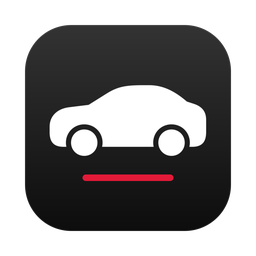

# Tesla Mac Widget

**Your Tesla on your Mac's desktop.**
Battery, lock, Sentry and location at a glance, and lock, climate, frunk and trunk one click away.


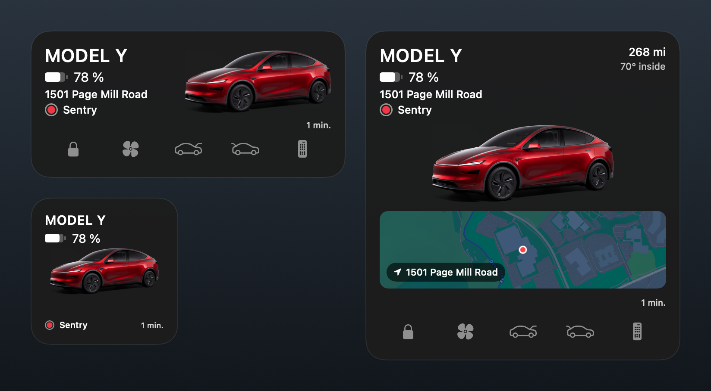

[Install](#install) · [Connect to Tesla](#connect-to-tesla) · [Using it](#using-it) · [Costs](#costs) · [Troubleshooting](#troubleshooting)

</div>

---

## What it does

| | |
|---|---|
| **At a glance** | Battery level, range, charging time left, locked or unlocked, Sentry, inside temperature, and the street the car is parked on. |
| **Your car, exactly** | The official render of *your* car (model, paint and wheels), taken from Tesla's own configurator using your car's option codes. |
| **One-click controls** | Lock or unlock, climate on or off, open the frunk or trunk, and trigger HomeLink for your garage. The widget updates the moment you click, and confirms with the car right after. |
| **Three sizes** | Small for battery and Sentry, medium for the status line and controls, large for a map of where the car is parked. |
| **Opens the Tesla app** | Click the car and the Tesla app opens through iPhone Mirroring, like Tesla's own iPhone widget does on a Mac. |
| **Stays free** | It checks the car every 15 minutes (every 5 while charging or driving), never wakes it on its own, and keeps itself under Tesla's free monthly credit. |
| **Private** | Data goes from Tesla's servers straight to your Mac. Your keys never leave it. |

<sub>The images above are rendered from the widget's own views with sample data, using <code>tools/render-media.sh</code>.</sub>

---

## Install

### What you need

- A Mac with **macOS 15 (Sequoia) or newer**
- **Xcode** from the App Store (free), opened once
- An **Apple ID** signed in to Xcode: *Xcode → Settings → Accounts → +*, then select your name → *Manage Certificates… → + → Apple Development*
- **[Homebrew](https://brew.sh)**
- A **GitHub** account (free). Tesla needs a small public website to trust your app, and the installer makes one for you on GitHub Pages
- A **Tesla account** that owns the car, with the Tesla app on your phone

### Run the installer

Open **Terminal** and paste these two lines:

```bash
git clone https://github.com/CristoXD73/tesla-mac-widget.git ~/tesla-mac-widget
cd ~/tesla-mac-widget && ./install.sh
```

It walks through seven steps and tells you what it's doing at each one:

```
  Tesla Mac Widget installer

  Step 1 of 7: Checking your Mac
     macOS 26.0 and Xcode are ready.
     Helper tools are installed.

  Step 2 of 7: Finding your Apple developer account
     Using Apple team A1B2C3D4E5.

  Step 3 of 7: Making your keys
     Keys are in ~/.tesla-widget. The private key never leaves this Mac.
     Tesla's command proxy is ready.

  Step 4 of 7: Publishing your public key
     Log in to GitHub in the browser window that opens (a free account is enough).
     Publish your public key on https://yourname.github.io? It is meant to be public. [y/n] y
     Your website is https://yourname.github.io
     Your public key is online.

  Step 5 of 7: Tesla's own look (optional)
     Use the Tesla app's icon from the App Store? It stays on this Mac. [y/n] y
     Downloaded the Tesla app icon.

  Step 6 of 7: Building the app
** BUILD SUCCEEDED **

  Step 7 of 7: Installing
     Installed in Applications. The car icon is now in your menu bar.

  All done. Next: "Connect to Tesla" in the README.
```

Keep the website it prints (`https://yourname.github.io`). You'll type it on Tesla's site next.
Run `./install.sh` again any time to update; it skips whatever is already done.

---

## Connect to Tesla

Tesla only lets apps read a car once they're registered on **[developer.tesla.com](https://developer.tesla.com)**.
It's a five-page form you fill in once, about ten minutes.

**1.** Sign in to [developer.tesla.com](https://developer.tesla.com) with the Tesla account that owns the car.
Tesla requires multi-factor authentication on that account; it will walk you through turning it on if it's off.

**2.** Choose **Create New Application** (it may read *Request App Access*). On the **Registration** page,
fill in your name and email and choose personal use if asked.

**3. Application Details.** Any wording works:

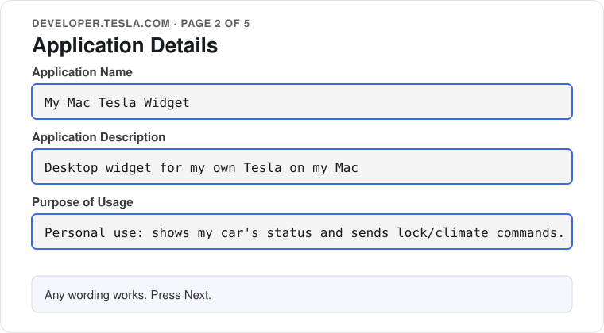

<details>
<summary>What the real page looks like</summary>

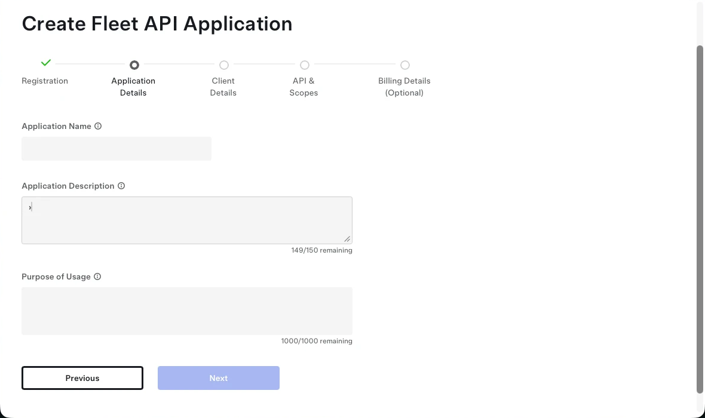
</details>

**4. Client Details.** This is the page that matters. Replace `YOURNAME` with your own website from the installer:

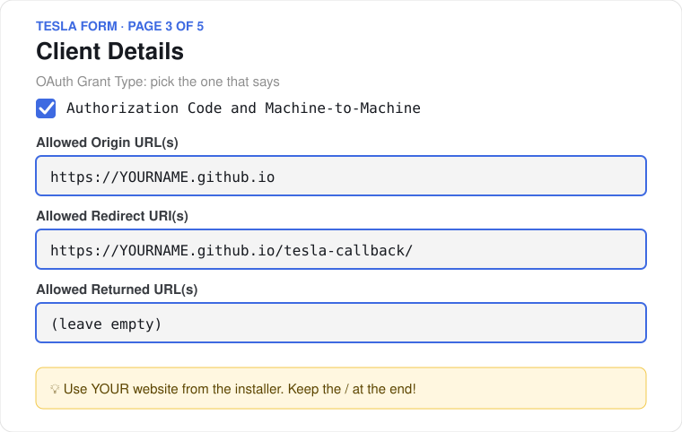

Both addresses must match exactly: `https`, lowercase, and the slash at the end of the redirect.
If a field has an **Add** button, press it, or the address isn't saved.

**5. API & Scopes.** Tick the four vehicle scopes:

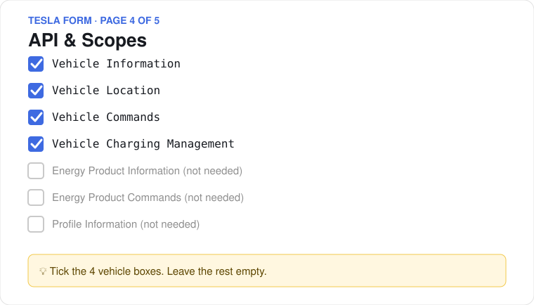

**6. Billing Details.** Add a payment method:

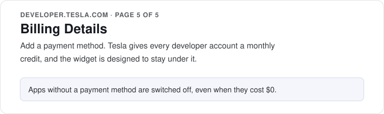

**7. Your two codes.** Open the app you just made on developer.tesla.com and copy its **Client ID** and
**Client Secret** (the eye icon reveals the secret). In the menu bar choose the car icon → **Setup & Status…** →
**Open credentials.env**, paste them after the `=` signs and save:

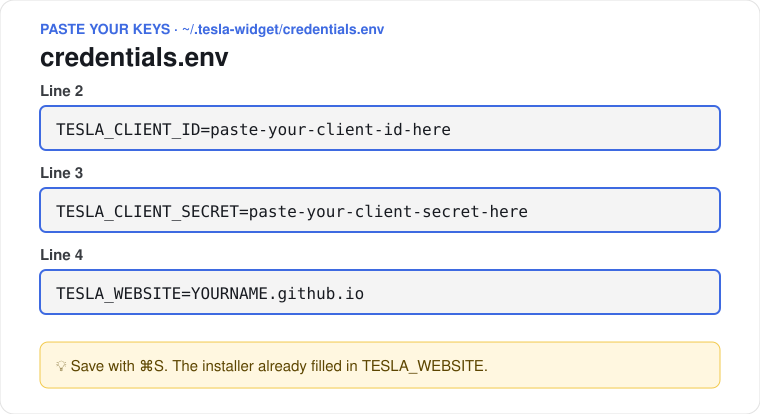

Treat the Client Secret like a password: don't share it or commit it anywhere.

### Finish in the setup window

Back in **Setup & Status…**, go down the list. Each step gets a green check when it's done:

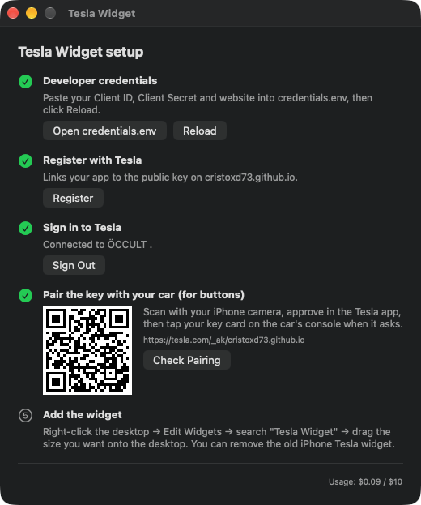

| # | Press | What happens |
|---|---|---|
| 1 | **Reload** | The app reads the codes you pasted. |
| 2 | **Register** | Tells Tesla about your website. It takes a second and nothing opens. |
| 3 | **Sign In** | Tesla's login opens in your browser. Sign in and allow access; if the browser asks to open Tesla Widget, allow that too. |
| 4 | **Pair the key** | Scan the QR code with your iPhone camera, approve in the Tesla app, then tap your key card on the car's console. Only the buttons need this. |
| 5 | **Add the widget** | Right-click the desktop → **Edit Widgets** → search **Tesla** → drag the size you want onto the desktop. |

Then turn on **Open at Login** in the car icon's menu, so the widget keeps updating after a restart.

---

## Using it

<table>
<tr>
<td width="33%" align="center"><b>Small</b><br>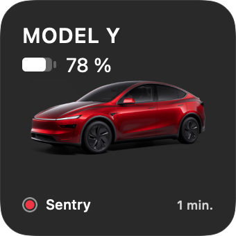</td>
<td width="33%" align="center"><b>Medium</b><br>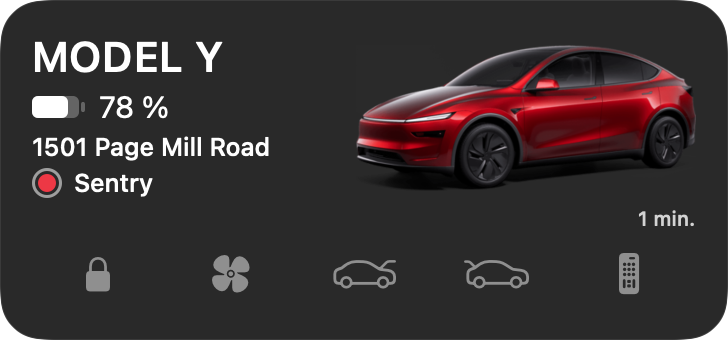</td>
<td width="33%" align="center"><b>Large</b><br>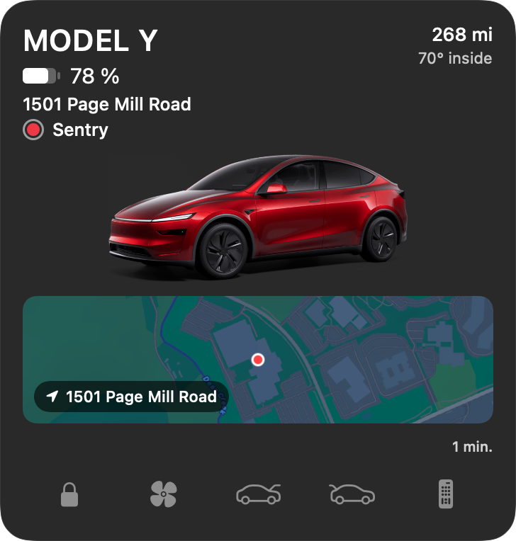</td>
</tr>
</table>

| Click | What happens |
|---|---|
| **Lock** | Locks or unlocks; the padlock opens when the car is unlocked |
| **Fan** | Climate on or off; it turns blue while on |
| **Frunk** / **Trunk** | Opens the front trunk / opens or closes the rear trunk |
| **HomeLink** | Opens your garage, if HomeLink is set up in the car |
| **The car** | Opens the Tesla app through iPhone Mirroring |

- A click changes the widget straight away and dims the button while the car answers, usually one to three seconds. If the car refuses, the widget flips back and shows the reason.
- If the car is asleep, the first click wakes it, so that one takes around ten seconds.
- Clicking the car opens iPhone Mirroring and searches your iPhone for Tesla. The first time, macOS asks to allow **Tesla Widget** under *Privacy & Security → Accessibility*; without it, the click only opens iPhone Mirroring.

The car icon's menu shows the latest status, **Refresh Now**, **Reload Car Image & Icons**, this month's API usage and **Open at Login**.

---

## Tesla's own look

The repository ships original look-alike icons and no Tesla artwork. You can still give your own copy the
real look for free; these files live in `~/.tesla-widget/overrides/` and never leave your Mac.

| | How | Cost |
|---|---|---|
| **Your car's photo** | Automatic. The app reads your car's option codes from the Fleet API and asks Tesla's configurator for the matching render. **Reload Car Image & Icons** fetches it again. | Free |
| **Tesla app icon** | Answer **y** in step 5 of the installer. It uses Apple's App Store lookup API (`itunes.apple.com/lookup?bundleId=com.teslamotors.TeslaApp`) to download the Tesla app's icon. | Free |
| **Button icons** | Screenshot (⌘⇧4) just the row of five buttons from the Tesla app's widget, light icons on a dark background, then run the command below and choose **Reload Car Image & Icons**. | Free |

```bash
swift ~/tesla-mac-widget/tools/slice-icons.swift ~/Desktop/tesla-buttons.png
```

It cuts out the five icons and makes an unlocked padlock to match. To use any other picture of
the car, save it as `~/.tesla-widget/overrides/car.png` and reload.

---

## Costs

Tesla charges developers per request and gives every account a monthly credit, about $10.
The widget is designed to stay well under it:

- It checks the car every **15 minutes**, or every **5** while charging, driving or with climate on.
- It **never wakes the car** by itself; only a button press does.
- It pauses while your screen is asleep.
- It counts its own requests (shown in the menu) and slows down, then stops checking, before reaching the credit.

Typical use comes to a few dollars of the credit, so nothing is charged to your card.

## Privacy

- Car data goes from Tesla's servers straight to your Mac. There are no other servers, accounts or analytics.
- The private key and Client Secret stay in `~/.tesla-widget` on your Mac.
- The public key on your website is meant to be public; it only lets Tesla check that commands really came from you.
- To revoke access, remove the key in the car under *Controls → Locks*, or delete the app on developer.tesla.com.

---

## Troubleshooting

<details>
<summary><b>"The 'redirect_uri' supplied is not registered for this 'client_id'"</b></summary>

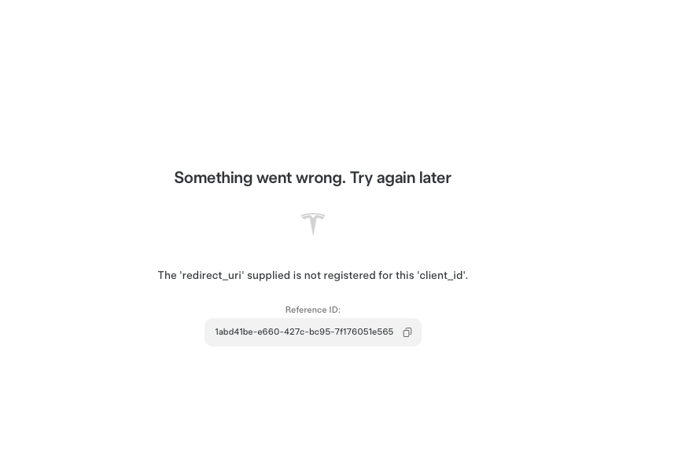

Tesla doesn't have your sign-in address. On developer.tesla.com, open your app → **Client Details → Edit** and check that:

- **Allowed Redirect URI(s)** is exactly `https://yourname.github.io/tesla-callback/`, slash included, and was added with the **Add** button if there is one.
- **OAuth Grant Type** includes **Authorization Code**.

Save, wait a minute and press **Sign In** again. If your Client Details still look like this, the change wasn't saved:

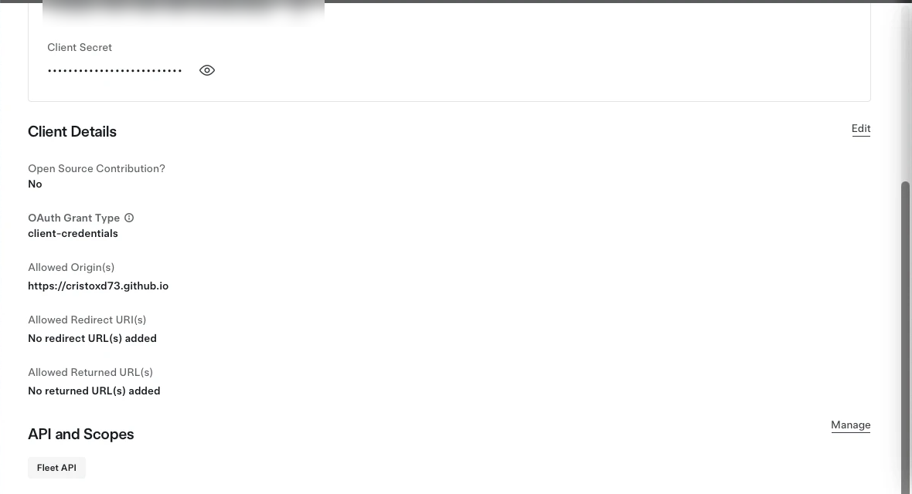
</details>

<details>
<summary><b>Register fails: "Root domain … must match registered allowed origin"</b></summary>

**Allowed Origin URL(s)** must be exactly `https://yourname.github.io`, with no slash or path after it.
</details>

<details>
<summary><b>The widget looks out of date after an update</b></summary>

macOS keeps the old widget running. Restart it, or restart your Mac:

```bash
pkill -f TeslaWidgetExtension; killall NotificationCenter
```
</details>

<details>
<summary><b>The buttons don't do anything</b></summary>

- The app has to be running (the car icon in the menu bar). Turn on **Open at Login**.
- The key has to be paired with the car: **Check Pairing** in the setup window should show a green check.
- The widget shows the car's reason when a command is refused.
</details>

<details>
<summary><b>The installer says there's no Apple developer certificate</b></summary>

In Xcode → **Settings → Accounts**, select your Apple ID → **Manage Certificates… → + → Apple Development**, then run `./install.sh` again.
</details>

---

## How it fits together

```
Tesla Fleet API ──► Tesla Widget (menu bar app) ──► desktop widget
                      │ sign-in, token refresh, polling, map, car render
Your car ◄── tesla-http-proxy ◄── widget buttons
            (Tesla's open-source command signer, run locally by the app)
```

```
App/       menu bar app: setup window, Tesla sign-in, polling, car render, map, command proxy
Widget/    the widget: small, medium and large layouts, and the button actions
Shared/    Fleet API client and the data both sides share
tools/     icon slicer, app icon maker, README image renderer
website/   the sign-in page the installer puts on your GitHub site
```

To uninstall, run `./uninstall.sh`. It removes the app and, if you say so, your keys and settings.

## Not affiliated

This is an independent project. It is not made, endorsed or supported by Tesla, Inc. "Tesla" is used only
to say which car it works with; the repository contains no Tesla artwork, and car renders are fetched from
Tesla's public configurator on your behalf.

## License

[MIT](LICENSE)
